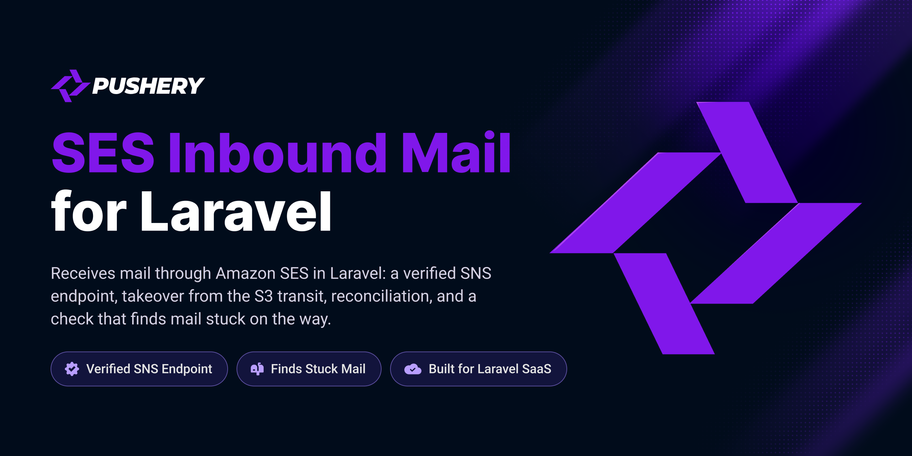

<p align="center">
  <a href="https://github.com/pushery/ses-inbound-mail-for-laravel">
    
  </a>
</p>

# SES Inbound Mail for Laravel

[](https://packagist.org/packages/pushery/ses-inbound-mail-for-laravel)
[](https://packagist.org/packages/pushery/ses-inbound-mail-for-laravel)
[](https://packagist.org/packages/pushery/ses-inbound-mail-for-laravel)
[](LICENSE)

[](https://pestphp.com)


[](https://phpstan.org)
[](https://laravel.com/docs/pint)

Receive mail through Amazon SES in Laravel: a verified SNS endpoint, takeover from the S3 transit, reconciliation, a check for stuck mail and AWS setup.

## Documentation

**Full documentation at
[docs.pushery.com/ses-inbound-mail-for-laravel](https://docs.pushery.com/ses-inbound-mail-for-laravel/).**
This README is the quick start; the guides and the configuration reference live
there.

## Requirements

- PHP 8.4+ (tested on 8.4.27, 8.5.x and 8.6.x)
- Laravel 13+

Tested on PostgreSQL 18.7 and MySQL 8.4.13, the databases Laravel Cloud runs (serverless Postgres
and MySQL 8.4 LTS). The fast suite runs on SQLite.

Tested on the floor of the declared PHP range, because a `>=` promise is only proven
by running on the boundary, and on the minor version above it, so the range above the
floor is exercised here rather than first by a consumer.

## Installation

```bash
composer require pushery/ses-inbound-mail-for-laravel
composer require league/flysystem-aws-s3-v3 "^3.0"
```

The service provider is registered automatically through package discovery. The second command
installs the Flysystem adapter for S3, which Laravel's `s3` driver needs for the transit disk that
SES stores every mail into.

## Configuration

Publish the configuration file:

```bash
php artisan vendor:publish --tag=ses-inbound-mail-config
```

This writes `config/ses-inbound-mail.php`, where every option is documented inline.

The package records every mail it receives in a table of its own, `ses_inbound_mails`, and
`php artisan migrate` runs its migrations from the package as they are. To keep the migrations in
your application instead, decide before your first `php artisan migrate`: call
`\Pushery\SesInboundMail\SesInboundMailServiceProvider::ignoreMigrations(tablesExist: true)` in the `register` method of your
`AppServiceProvider` first, then publish and run them:

```bash
php artisan vendor:publish --tag=ses-inbound-mail-migrations
php artisan migrate
```

Without that call both copies stay registered: the package goes on migrating its table from its
own files, and the published copies, which Laravel's default configuration gives a new name, find
the table built. The same goes for `--tag=ses-inbound-mail`, which publishes every resource at
once, the migrations included.

`tablesExist: true` says that your application migrates the table itself, so the package keeps
scheduling the reconciliation and the prune of the retention, which both read it. Called without
it, `ignoreMigrations()` takes both off the schedule, as for an application that has no such table.

Publish the migrations once. The release notes name each migration a later release adds: copy
that file from `vendor/pushery/ses-inbound-mail-for-laravel/database/migrations` into
`database/migrations`, renamed to start with today's date so it runs after the copies you have,
then run `php artisan migrate`. Publishing the tag again writes every migration a second time under a
new date, and `migrate` runs each copy as a new migration over the tables the original
created. If `php artisan migrate` has already run them from the package, copy the files from
that directory under their own names instead of publishing them: the `migrations` table knows
them by those names, so `migrate` leaves them alone.

## Usage

Write what your application does with a received mail as a class of its own, here
`app/Mail/OpenAConversation.php`:

```php
<?php

namespace App\Mail;

use Pushery\SesInboundMail\Contracts\ReceivesInboundMail;
use Pushery\SesInboundMail\ReceivedMail;

final class OpenAConversation implements ReceivesInboundMail
{
    public function receive(ReceivedMail $mail): void
    {
        // The original lies on $mail->disk under $mail->path, with $mail->sha256.
    }
}
```

Bind it in the `register()` method of a service provider of your application, such as
`App\Providers\AppServiceProvider`:

```php
use App\Mail\OpenAConversation;
use Pushery\SesInboundMail\Contracts\ReceivesInboundMail;

$this->app->bind(ReceivesInboundMail::class, OpenAConversation::class);
```

Amazon SES receives mail for your domain only once the domain is a verified identity of SES, its
MX record points to SES and the receipt rule set `inbound` is the active one in your AWS account.
[Before you start](https://docs.pushery.com/ses-inbound-mail-for-laravel/#before-you-start) gives
the commands, each run once with the credentials of an administrator of the account.

Write into the `.env` of your application the topics of Amazon SNS the endpoint takes and what the
setup in AWS sets up. The topic of the setup is one of the topics, by the ARN its region, account
and name make:

```dotenv
SES_INBOUND_MAIL_TOPICS=arn:aws:sns:eu-central-1:123456789012:inbound-mail
SES_INBOUND_MAIL_AWS_REGION=eu-central-1
SES_INBOUND_MAIL_AWS_ACCOUNT=123456789012
SES_INBOUND_MAIL_TOPIC=inbound-mail
SES_INBOUND_MAIL_BUCKET=inbound-mail-transit
SES_INBOUND_MAIL_RULE=inbound-mail
SES_INBOUND_MAIL_RECIPIENTS=inbox.example.com
SES_INBOUND_MAIL_ENDPOINT=https://api.example.com/ses-inbound-mail/notifications
SES_INBOUND_MAIL_IAM_USER=inbound-mail-app
```

Deploy the application with them, then set up the receiving path in AWS, with the keys of an
administrator in front of the command as
[Setting up AWS](https://docs.pushery.com/ses-inbound-mail-for-laravel/#setting-up-aws) shows:

```bash
php artisan ses-inbound-mail:setup-aws
```

SNS delivers to `POST /ses-inbound-mail/notifications`, every message is checked against its
signature, and every mail is taken over once, byte for byte, before your application receives it.
A reconciliation every five minutes takes what no notification reported.
[The documentation](https://docs.pushery.com/ses-inbound-mail-for-laravel/) describes every step and setting.

## Testing

The test suite is not part of the published package: the tests and their PHPUnit
configuration stay in the development repository, so a clone of this repository has no
`composer test`. [CONTRIBUTING.md](https://github.com/pushery/ses-inbound-mail-for-laravel/blob/main/CONTRIBUTING.md) says how a change is tested on its way in.

## Security

Please review the [security policy](SECURITY.md) and report vulnerabilities
privately rather than opening a public issue.

## Built by PUSHERY

This package is built and maintained by [PUSHERY](https://www.pushery.com) — a
Berlin-based studio building Laravel applications, SaaS products, and open-source
tools.

Building a Laravel UI? [WireKit](https://www.wirekit.app) is PUSHERY's open-source
Livewire component kit.
Browse the rest of our work at [pushery.com](https://www.pushery.com).

## License

The MIT License (MIT). See [LICENSE](LICENSE) for details.
