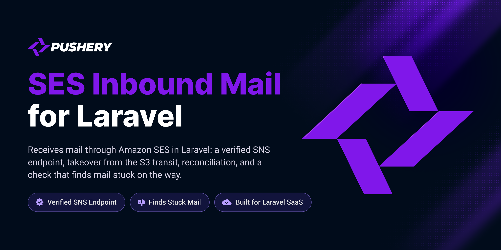

<p align="center">
  <a href="https://github.com/pushery/ses-inbound-mail-for-laravel">
    
  </a>
</p>

# SES Inbound Mail for Laravel

[](https://packagist.org/packages/pushery/ses-inbound-mail-for-laravel)
[](https://packagist.org/packages/pushery/ses-inbound-mail-for-laravel)
[](https://packagist.org/packages/pushery/ses-inbound-mail-for-laravel)
[](LICENSE)

[](https://pestphp.com)


[](https://phpstan.org)
[](https://laravel.com/docs/pint)

Receive mail through Amazon SES in Laravel: a verified SNS endpoint, takeover from the S3 transit, reconciliation, a check for stuck mail and AWS setup.

## Documentation

**Full documentation at
[docs.pushery.com/ses-inbound-mail-for-laravel](https://docs.pushery.com/ses-inbound-mail-for-laravel/).**
This README is the quick start; the guides and the configuration reference live
there.

## Requirements

- PHP 8.4+
- Laravel 13+

Tested on PostgreSQL and MySQL 8.4, the databases Laravel Cloud runs (serverless Postgres
and MySQL 8.4 LTS), so it runs there out of the box. The fast suite runs on SQLite.

Tested on **PHP 8.4** — the floor of the declared range, because a `>=` promise is
only proven by running on the boundary — and on **PHP 8.5**, so the upper half of
`^8.4` is exercised here rather than first by a consumer.

## Installation

```bash
composer require pushery/ses-inbound-mail-for-laravel
```

The service provider is registered automatically through package discovery.

## Configuration

Publish the configuration file:

```bash
php artisan vendor:publish --tag=ses-inbound-mail-config
```

This writes `config/ses-inbound-mail.php`, where every option is documented inline.

The package records every mail it receives in a table of its own, `ses_inbound_mails`, and
`php artisan migrate` runs its migration from the package as it is. To keep the migration in your
application instead, call
`\Pushery\SesInboundMail\SesInboundMailServiceProvider::ignoreMigrations()` in the `register` method of your
`AppServiceProvider` first, then publish and run it:

```bash
php artisan vendor:publish --tag=ses-inbound-mail-migrations
php artisan migrate
```

Without that call both copies stay registered, and with Laravel's default configuration the
published one runs under a new name and fails on a table that already exists. The same goes
for `--tag=ses-inbound-mail`, which publishes every resource at once, the migrations included.

## Usage

Bind what your application does with a received mail:

```php
use Pushery\SesInboundMail\Contracts\ReceivesInboundMail;
use Pushery\SesInboundMail\ReceivedMail;

final class OpenAConversation implements ReceivesInboundMail
{
    public function receive(ReceivedMail $mail): void
    {
        // The original lies on $mail->disk under $mail->path, with $mail->sha256.
    }
}

$this->app->bind(ReceivesInboundMail::class, OpenAConversation::class);
```

Name the topics of Amazon SNS the endpoint takes, and set up the receiving path in AWS:

```bash
SES_INBOUND_MAIL_TOPICS=arn:aws:sns:eu-central-1:123456789012:inbound-mail
php artisan ses-inbound-mail:setup-aws
```

SNS delivers to `POST /ses-inbound-mail/notifications`, every message is checked against its
signature, and every mail is taken over once, byte for byte, before your application receives it.
A reconciliation every five minutes takes what no notification reported.
[The documentation](https://docs.pushery.com/ses-inbound-mail-for-laravel/) describes every step and setting.

## Testing

The test suite is not part of the published package: the tests and their PHPUnit
configuration stay in the development repository, so a clone of this repository has no
`composer test`. [CONTRIBUTING.md](CONTRIBUTING.md) says how a change is tested on its way in.

## Security

Please review the [security policy](SECURITY.md) and report vulnerabilities
privately rather than opening a public issue.

## Built by Pushery

This package is built and maintained by [Pushery](https://www.pushery.com) — a
Berlin-based studio building Laravel applications, SaaS products, and open-source
tools.

Building a Laravel UI? [WireKit](https://www.wirekit.app) is Pushery's open-source
Livewire component kit.
Browse the rest of our work at [pushery.com](https://www.pushery.com).

## License

The MIT License (MIT). See [LICENSE](LICENSE) for details.
